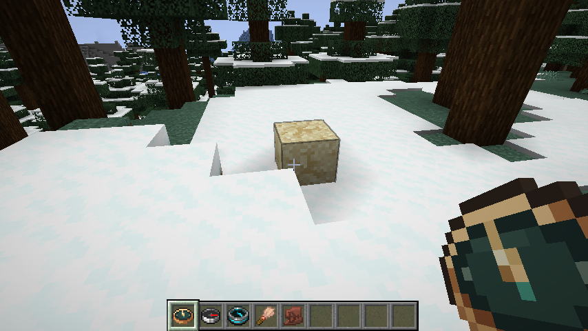
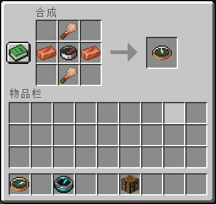
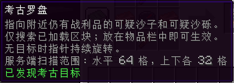

# 考古罗盘（Archaeology Compass）

探索遗迹时，带上一枚考古罗盘，寻找附近仍藏着战利品的可疑方块——原版的可疑沙子和可疑沙砾，以及其他模组添加的考古方块。

## 功能

- 指向附近最近的有效考古目标。
- 目标被刷空、挖掉或离开扫描范围后，自动重新寻找。
- 找不到目标时，指针持续旋转。
- 放在物品栏中即可生效，不需要一直拿在手里。
- 按住 **Shift** 查看扫描范围和当前搜索状态。
- 只搜索已加载的区块，不会为寻找目标加载远处区域。
- 扫描范围和更新频率可由服务器调整。
- **自动识别任何使用原版刷扫机制的方块**，整合包和第三方模组添加的自定义考古方块无需数据包或额外配置。

它寻找的是考古方块，而不是远处的遗迹建筑。默认水平扫描范围为 **64 格**，上下各 **32 格**。

## 外观

原创 **32×32 铜制罗盘**，采用接近原版指南针的斜视外观。V2 使用两行铜制侧壁和一行暗色收边，兼顾厚度感与轻巧感。浅金色长针指向目标，绿色短尾用于区分方向。

*美术动画预览，非游戏截图。*

## 游戏截图

*玩家正对可疑沙子，指针指向正前方。快捷栏第 2 格是原版指南针——两者指向互不影响，可以对照看出考古罗盘只追踪考古目标。*

*上中与下中放刷子，中间一排是铜锭、指南针、铜锭。*

*按住 Shift 可查看扫描规则、服务器范围，以及当前的搜索状态。*

## 合成

需要 **两把刷子、两个铜锭和一个指南针**，在工作台中按以下方式摆放：

| | | |
| :---: | :---: | :---: |
| | 刷子 | |
| 铜锭 | 指南针 | 铜锭 |
| | 刷子 | |

获得刷子或指南针后即可解锁配方书中的配方。安装对应版本的 JEI 后，也可查看合成配方；JEI 不是必需的。

## 下载与安装

前往 [Releases 下载页面](https://github.com/luanma114/archaeology-compass/releases)，选择与你的游戏版本匹配的 JAR，放入 `mods` 文件夹。

- **Minecraft：1.21.1**
- **NeoForge：21.1.235 及以上的 1.21.1 兼容版本**
- **Java：21**

单人游戏安装到客户端；多人游戏需要客户端和服务器都安装。

当前版本为 **v0.1.3**。相比 0.1.2，目标判定不再依赖方块标签：任何使用原版刷扫机制（`BrushableBlockEntity` 及其子类）且仍有战利品的方块都会被识别，因此整合包和第三方模组添加的自定义考古方块开箱即用。定位范围、配方和指针逻辑未改。

已在开发客户端的新建存档中确认合成、指针指向目标与 Shift 提示；发布 JAR 的干净实例安装、独立服务器联机、JEI 展示及大范围性能本次未验证，页面不作相关声明。更新内容和已知限制见对应 Release 说明。

## 反馈

发现问题或有建议，欢迎提交 [Issue](https://github.com/luanma114/archaeology-compass/issues)。

## 许可与开发资料

代码采用 [MIT](LICENSE)，美术采用 [CC BY 4.0](LICENSE_ASSETS)，具体范围以许可文件为准。

开发、资源制作和测试说明见 [开发文档](docs/NeoForge_MC模组开发文档.md)。
